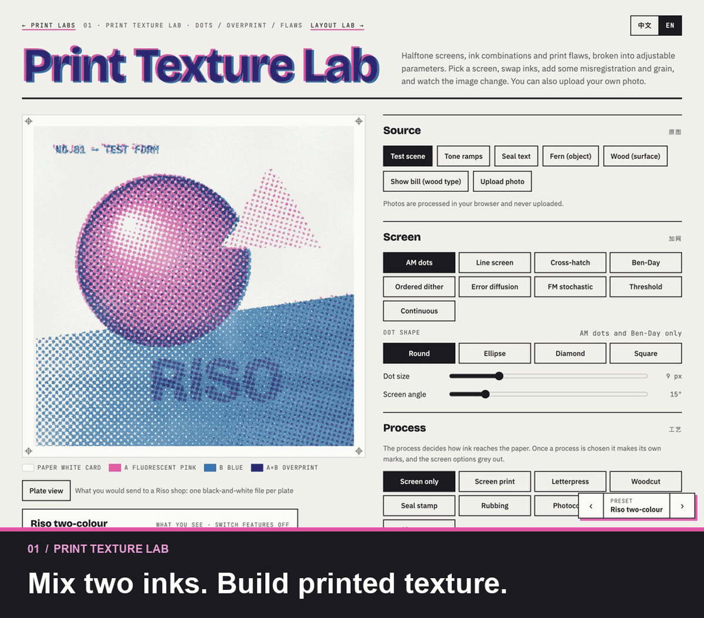

# Print Labs

**English** · [简体中文](README.zh-CN.md)

[Open the labs ↗](https://gengyuanmax.github.io/print-lab/) · [GitHub source ↗](https://github.com/gengyuanmax/print-lab)

A visual playground for learning how print-inspired design works. Experiment with halftones, ink, typography, composition and paper formats by changing the settings and watching the results.

The project is also a record of learning to design with AI: understanding the building blocks, making deliberate choices, and finding better ways to communicate a visual idea.

## Explore the four labs

| Lab | What you can try |
| --- | --- |
| [01 · Print Texture Lab](https://gengyuanmax.github.io/print-lab/print.html) | Turn an image into dots and ink. Compare screens, printing processes, overprinting and paper textures. |
| [02 · Layout Lab](https://gengyuanmax.github.io/print-lab/layout.html) | Build posters with adjustable grids, typography, colour and collage. Compare styles and export your design. |
| [03 · Object Lab](https://gengyuanmax.github.io/print-lab/object.html) | Explore how flat sheets become zines, folded leaflets and booklets. See page order, folds, bleed and safe areas. |
| [04 · Element Lab](https://gengyuanmax.github.io/print-lab/element.html) | Restyle web components, process photos, and combine shapes, text and images with different ink and masking effects. |

**A good place to start:** open Print Texture Lab, try the Riso preset, and change the dot size or ink colours. Then move to Layout Lab and see how the same visual ideas work in a poster.

Switch between English and Chinese in the top-right corner of any page. The site remembers your choice. Uploaded images are processed locally in your browser.

<details>
<summary><strong>Watch a 26-second demo</strong></summary>

[](https://gengyuanmax.github.io/print-lab/)

</details>

## A closer look

<details>
<summary><strong>01 · Print Texture Lab — screens, ink and paper</strong></summary>

- **Screens and tone:** AM dots, line screens, cross-hatching, Ben-Day dots, Bayer dithering, Floyd–Steinberg error diffusion, FM stochastic screens, threshold and continuous tone. Adjust contrast, tonal range and dot shape.
- **Printing processes:** screen printing, letterpress, woodcut, seals, rubbing, photocopying, cyanotype and photogram simulations. Explore worn wood type, repeated photocopying and aged paper.
- **Ink and texture:** one, two or three inks; duotones and gradient mapping; transparent overprinting or opaque coverage. Add misregistration, grain, ink starvation, roller marks and dot gain.
- **Compare and learn:** start from 28 presets, switch individual features off, compare tonal transitions and inspect black-and-white plate views. Controls include explanations and source links.

</details>

<details>
<summary><strong>02 · Layout Lab — grids, type and composition</strong></summary>

- **Six starting points:** Swiss, Halftone, Riso zine, Editorial, Constructivist and Wood-type poster. Shuffle the composition while keeping the same design rules.
- **Layout controls:** grids, margins, type hierarchy, spacing, alignment, whitespace, reading paths, shapes and ink colours. Chinese typesetting includes line-break rules and Chinese–Latin spacing.
- **Print and collage:** halftones, cutouts, torn edges, tape, seals and whole-poster texture. Try multi-page layouts, print marks and optional motion.
- **Compare and export:** compare presets side by side, inspect grid and reading-order overlays, and export PNG or SVG from the hosted site. Layout metrics are simplified estimates for comparing experiments.

</details>

<details>
<summary><strong>03 · Object Lab — from a sheet to a booklet</strong></summary>

- Explore a single-sheet poster, an eight-page folded zine, a bifold, a trifold and a saddle-stitched booklet.
- Switch between print-sheet and reading views to understand page order and imposition.
- Adjust paper size, bleed, safe margins, stock weight and printing method. Inspect folds, cuts and estimated booklet creep.
- This is a lightweight learning model. Its preflight notes do not replace a print shop's production requirements.

</details>

<details>
<summary><strong>04 · Element Lab — components, photos and composition</strong></summary>

- **Restyle familiar elements:** navigation, buttons, cards, icons, labels and more. Compare the original with Swiss-inspired, Riso-inspired or paper-based treatments.
- **Process images:** crop, mirror, remove a colour background, make silhouettes or line art, add halftones and try offset copies or scan-like distortions.
- **Compose one or two elements:** position shapes, text, photos, drawings or objects directly on the canvas, then compare overprint, knockout, trapping, weaving and clipping masks.
- **Understand the result:** sourced notes distinguish printing guidance from visual design choices. Background removal, tint simulation and fit checks are simplified demonstrations.

</details>

## Run locally

No package installation or application server is required. To serve a local copy:

```sh
git clone https://github.com/gengyuanmax/print-lab.git
cd print-lab
python3 -m http.server 8000 --bind 127.0.0.1
```

Open [localhost:8000](http://localhost:8000). You can also open `index.html` directly in a browser.

Fonts load from Google Fonts. Layout export loads `html-to-image` on demand; uploaded photos remain in your browser.

## Edit and build

Edit the files in `src/`, then rebuild:

```sh
python3 build.py
```

| Location | Purpose |
| --- | --- |
| `src/home.html` | Homepage content and sharing metadata |
| `src/print.html`, `src/layout.html`, `src/object.html`, `src/element.html` | Lab content and interactions |
| `src/shared.css` | Shared colours, typography, layout and controls |
| `src/links.js` | Navigation for local pages, GitHub Pages and Claude artifacts |
| `assets/social/` | Demo GIFs and social preview images |
| Root HTML files | Generated pages served by GitHub Pages; do not edit directly |
| `dist/` | Generated body-only versions for Claude artifacts; not committed |

Keep this file and [the Chinese README](README.zh-CN.md) in sync when changing the documentation.

<details>
<summary><strong>Sharing the site on LinkedIn and other platforms</strong></summary>

The homepage includes an English Open Graph title, description, animated demo and static alternative. The share assets (`assets/social/print-lab-share-en.gif` and `.jpg`) are 1200 × 630, with side padding to preserve the full interface and captions. The original-ratio demo is `assets/social/print-lab-demo-en.gif`; both GIFs are below 5 MB.

Platforms control cropping, image selection and animation playback. Use [LinkedIn Post Inspector](https://www.linkedin.com/post-inspector/) to check or refresh a link preview after deployment. For a media post, upload the GIF or video directly and include the website URL in the text.

</details>

## Sources and limitations

Explanations and reference links are available in the labs. The controls bring together ideas from printing and graphic design; they are not a reproduction of one book or design system. Corrections and additional references are welcome through [GitHub issues](https://github.com/gengyuanmax/print-lab/issues).

Ink colours, textures and print checks are screen simulations. For production, use your printer's physical swatches and specifications.

<details>
<summary><strong>A few terms used in the labs</strong></summary>

| Term | Meaning here |
| --- | --- |
| Halftone | Dots that reproduce tonal variation; AM varies dot size, while FM varies their distribution. |
| Knockout | Removing underlying ink so paper or another colour can show through. |
| Reversed-out type | Light lettering formed by leaving an area unprinted against a dark background. |
| Plate inversion | Swapping inked and uninked areas on one plate; other plates may still print there. |
| Trapping | A small overlap between neighbouring colours to reduce gaps from misregistration. |
| Dot gain | An increase in the area covered by printed dots. |
| Photogram | An image made by exposing objects on a light-sensitive surface, without a camera. |
| Creep | The outward shift of inner pages when folded sheets are nested into a booklet. |
| Set to measure | Fitting a line of type to a chosen width; the lab simulates this for wood-type posters. |
| Foxing | Brown or reddish spots associated with paper ageing; not simply another word for mould. |

Selected references: [Adobe on overprinting](https://helpx.adobe.com/cn/illustrator/using/overprinting.html), [Adobe on trapping](https://helpx.adobe.com/cn/illustrator/using/trapping.html), [MoMA on photograms](https://www.moma.org/collection/terms/photogram), [W3C Chinese Layout Requirements](https://www.w3.org/TR/clreq/) and [Adobe on booklet printing](https://helpx.adobe.com/cn/indesign/desktop/print/print-booklets/booklet-printing-settings.html).

</details>

## License and credits

- **Code:** MIT.
- **Written content and generated example artwork:** CC BY 4.0. Credit Print Labs when reusing or adapting them.
- Fonts, linked references and trademarks are covered by their respective owners' terms.

See [LICENSE](LICENSE) for the full scope. Created by [Gengyuan Zhang](https://gengyuanmax.github.io/) in collaboration with Claude.
